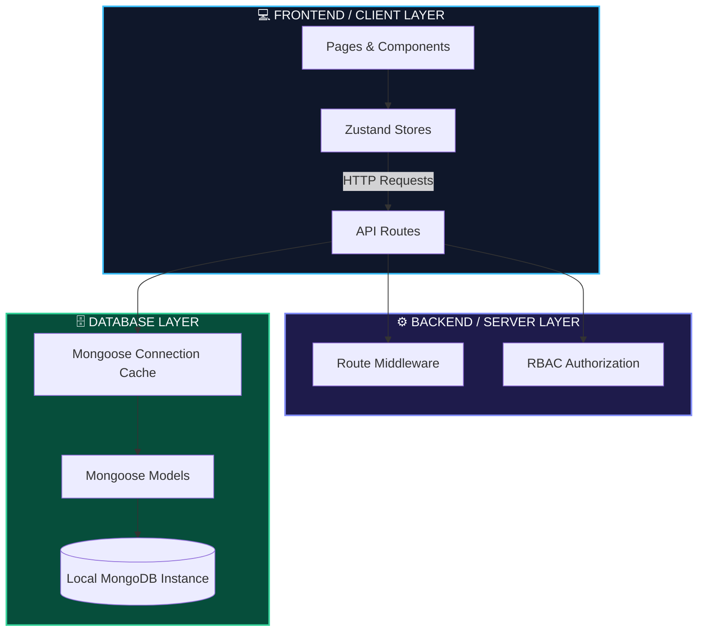

# DevOps Resource Management Platform - Directory Guide

This guide categorizes and explains the files in the codebase, dividing them into **Database**, **Backend (API)**, and **Frontend (UI)** layers. This is structured to help you easily understand and explain the architecture during your **college viva**.

---

## 🗺️ High-Level Architecture Overview

---

## 📂 Category Sections

### 1. 🗄️ Database Layer
Handles database connections, data models, schema validations, and mock data tests.

| File Path | Description | Key Tech / Features |
| :--- | :--- | :--- |
| 📄 [`lib/db.ts`](file:///c:/Users/15110/OneDrive/Desktop/mini%20project/devops-resource-management-platform/lib/db.ts) | MongoDB connection utility. | **Mongoose**, Connection Caching (prevents memory leaks during Next.js hot-reloads). |
| 📄 [`models/User.ts`](file:///c:/Users/15110/OneDrive/Desktop/mini%20project/devops-resource-management-platform/models/User.ts) | Schema definition for system users. | Mongoose Schema. Properties: `name`, `email` (unique), `password` (select: false), `role`. |
| 📄 [`models/Resource.ts`](file:///c:/Users/15110/OneDrive/Desktop/mini%20project/devops-resource-management-platform/models/Resource.ts) | Schema definition for virtual infrastructure. | Mongoose Schema. Properties: `name`, `type` (server/DB/container), `specs`, `owner` (ref User). |
| 📄 [`models/Deployment.ts`](file:///c:/Users/15110/OneDrive/Desktop/mini%20project/devops-resource-management-platform/models/Deployment.ts) | Schema definition for software deployments. | Mongoose Schema. Properties: `resourceId` (ref Resource), `version`, `deployedBy` (ref User). |
| 📄 [`scripts/test-db.ts`](file:///c:/Users/15110/OneDrive/Desktop/mini%20project/devops-resource-management-platform/scripts/test-db.ts) | Independent database connection and seed script. | Standalone TypeScript tester (creates the first mock admin user in MongoDB). |

---

### 2. ⚙️ Backend / Server Layer
Handles HTTP routing, request validation, cryptographic JWT creation, and role-based permissions (RBAC).

| File Path | Description | Key Tech / Features |
| :--- | :--- | :--- |
| 📄 [`middleware.ts`](file:///c:/Users/15110/OneDrive/Desktop/mini%20project/devops-resource-management-platform/middleware.ts) | Root path guard interceptor. | **Edge Runtime**, **Web Crypto API** (validates JWT cookies and protects `/dashboard/*` paths). |
| 📄 [`lib/auth.ts`](file:///c:/Users/15110/OneDrive/Desktop/mini%20project/devops-resource-management-platform/lib/auth.ts) | Hashing, JWT signing, and route protection HOC. | **bcryptjs** (hashing), **jsonwebtoken** (signing), `requireRole` endpoint authorization wrapper. |
| 📄 [`lib/roles.ts`](file:///c:/Users/15110/OneDrive/Desktop/mini%20project/devops-resource-management-platform/lib/roles.ts) | System roles permission matrix. | Defines action list (`create_resource`, etc.) mapped to roles (`admin`, `devops_engineer`, `viewer`). |
| 📁 [`app/api/auth/`](file:///c:/Users/15110/OneDrive/Desktop/mini%20project/devops-resource-management-platform/app/api/auth) | API routes handling user lifecycle sessions. | Contains `/register` (POST user creation), `/login` (POST cookie setting), and `/logout` (cookie wipe). |
| 📁 [`app/api/resources/`](file:///c:/Users/15110/OneDrive/Desktop/mini%20project/devops-resource-management-platform/app/api/resources) | API routes handling resource data operations. | CRUD routes. Creation is locked to Admin/DevOps roles, deletion is restricted to Admin role. |
| 📁 [`app/api/deployments/`](file:///c:/Users/15110/OneDrive/Desktop/mini%20project/devops-resource-management-platform/app/api/deployments) | API routes tracking environment code updates. | Log creation (POST) and history retrieval (GET) endpoints. |

---

### 3. 💻 Frontend / Client Layer
Handles the user interface screens, UI components, custom styling, animations, and global client-side state.

| File Path | Description | Key Tech / Features |
| :--- | :--- | :--- |
| 📁 [`app/(auth)/`](file:///c:/Users/15110/OneDrive/Desktop/mini%20project/devops-resource-management-platform/app/(auth)) | Authentication pages. | Login (`/login`) and Registration (`/register`) UI screens styled with modern, dark layouts. |
| 📁 [`store/`](file:///c:/Users/15110/OneDrive/Desktop/mini%20project/devops-resource-management-platform/store) | Client-side reactive stores. | **Zustand** stores (`resourceStore.ts`, `deploymentStore.ts`) to manage list syncing and async fetch states. |
| 📁 [`components/ui/`](file:///c:/Users/15110/OneDrive/Desktop/mini%20project/devops-resource-management-platform/components/ui) | Atomic, reusable styling elements. | **shadcn/ui** Button and **Vengence UI** PopButton (implements custom hover states with Framer Motion). |
| 📄 [`lib/utils.ts`](file:///c:/Users/15110/OneDrive/Desktop/mini%20project/devops-resource-management-platform/lib/utils.ts) | Styling merger helper. | `clsx` and `tailwind-merge` (`cn` helper to blend conditional classes). |
| 📄 [`types/index.ts`](file:///c:/Users/15110/OneDrive/Desktop/mini%20project/devops-resource-management-platform/types/index.ts) | Shared Type Definitions. | TypeScript Interfaces representing User, Resource, and Deployment objects on the client. |

---

## 🎓 Viva Talking Points (Quick Answers)

1. **Why Next.js?**
   - *"Next.js allows us to build a full-stack project in a single repository. The App Router handles both frontend pages and backend API routes, which communicate seamlessly."*
2. **How does Authentication work?**
   - *"When a user logs in, the backend signs a JSON Web Token (JWT) with their userId and role. This token is written as a secure, HTTP-only cookie. On subsequent requests, the server inspects this cookie to authenticate the user."*
3. **How does Route Protection work?**
   - *"We use root `middleware.ts` running on the Next.js Edge Runtime. It intercepts requests going to `/dashboard`, checks the signature of the JWT cookie using the Web Crypto API, and redirects unauthorized users to `/login` immediately."*
4. **Why Zustand?**
   - *"Zustand is a lightweight state management library. It is much easier to set up than Redux and uses React hooks to easily subscribe components to state changes, like when the list of resources updates."*
